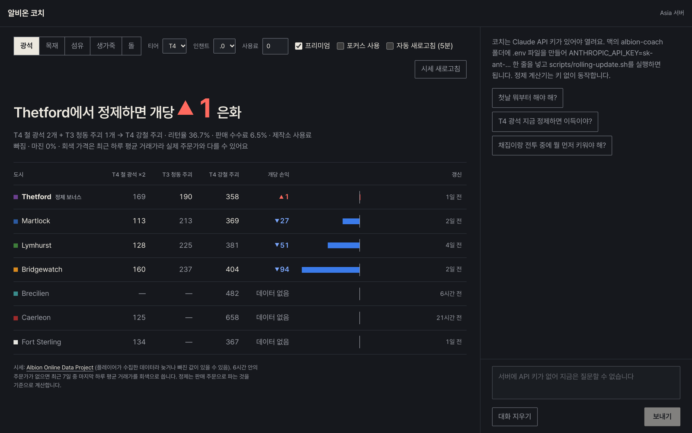

# 알비온 코치

알비온 온라인 Asia 서버용 보조 도구입니다. 게임 옆 화면(보조 모니터나 휴대폰)에 띄워 두고 씁니다.

- **정제 계산기**: Asia 서버 실시간 시세로 도시별 정제 손익, 리턴율, 운반 경로를 보여 줍니다. API 키 없이 동작합니다.
- **코치**: 한국어로 묻고 답합니다. 조사한 초반 가이드(`knowledge/guide.md`), 실시간 시세, 공개 캐릭터 명성을 도구로 확인하고, 가이드에 없는 내용은 웹에서 찾아 출처와 함께 답합니다. `ANTHROPIC_API_KEY`가 필요합니다.

게임 클라이언트에 입력을 보내거나 게임 메모리·패킷을 읽지 않습니다. 쓰는 데이터는 모두 공개 API입니다.



## 빠른 시작

```sh
git clone https://github.com/yun4010608-netizen/albion-coach.git && cd albion-coach
cp .env.example .env          # 코치를 쓸 때만: ANTHROPIC_API_KEY= 뒤에 키 입력 (.env는 커밋·이미지에 안 들어감)
docker compose up -d --build  # 앱 2개 + nginx 로드밸런서
```

`http://localhost:8080`을 엽니다. 화면 사용법, 휴대폰 접속, 문제 해결은 **[사용 가이드](docs/USAGE.md)** 에 있습니다.

## 무중단 운영

| 상황 | 동작 |
| --- | --- |
| 요청 처리 | 서버에 상태가 없습니다. 대화 기록은 브라우저에 있고, 어느 레플리카든 같은 답을 냅니다. |
| 재시작 (`scripts/rolling-restart.sh`) | 레플리카를 하나씩 재시작하고, 다시 healthy가 된 뒤 다음 것을 재시작합니다. |
| 새 이미지 (`scripts/rolling-update.sh`) | 새 레플리카 세트를 옆에 띄우고, 모두 healthy가 되면 옛 레플리카를 drain 후 내립니다. |
| 종료 신호 | 리스너를 바로 닫아 nginx가 다른 레플리카로 넘기고, 진행 중인 코치 답변은 최대 200초 기다립니다(`stop_grace_period` 210초). |
| 레플리카 장애 | nginx가 연결 실패나 사라진 IP를 다음 레플리카로 재시도합니다. 앱이 직접 낸 오류는 재시도하지 않습니다. |
| 시세 API 한도(429) | 5분간 호출을 멈추고 캐시를 씁니다. 반복 호출하면 차단되기 때문입니다. |

검증(2026-11-20, 로컬 compose): 롤링 재시작 2회와 롤링 이미지 교체 1회를 하는 동안 요청 7,588건이 모두 200이었습니다. 코치 답변(17초)이 진행되는 도중에 두 레플리카를 차례로 재시작해도 답이 끝까지 왔습니다(HTTP 200).

알려진 한계:
- 시세 캐시가 레플리카마다 따로 있습니다. 레플리카 수만큼 외부 호출이 늘어나니, 5개를 넘기거나 429가 보이면 Redis 같은 공유 캐시로 옮기세요.

## 테스트

```sh
go test ./...
```

## 도구 선택

| 영역 | 선택 | 대안 | 이유 | 라이선스 |
| --- | --- | --- | --- | --- |
| 서버 | Go 1.27.4 | Node/TypeScript, Python FastAPI | 단일 정적 바이너리라 scratch 이미지로 충분하고, graceful shutdown이 표준 라이브러리에 있음. 1.27.4는 2026-11-10 보안 릴리스(CVE 12건) | BSD-3-Clause |
| Claude 연동 | anthropic-sdk-go v2.12.0 (tool runner) | 직접 HTTP 호출, TypeScript SDK | 공식 SDK, 도구 호출 루프 내장 | MIT |
| 모델 | `claude-sonnet-5-5` (effort medium, server-side fallback) | `claude-opus-5-5` | 사용자 선택(2026-11-20): 코치 대화에 충분하고 더 저렴함. `.env`의 `CLAUDE_MODEL`로 바꿀 수 있음 | 상용 API |
| 웹 검색 | Claude 서버 측 `web_search_20250305` (API 호출마다 최대 5회) | `web_search_20260209`(동적 필터링), Brave Search API, Tavily | 키·코드를 더 두지 않고 API 안에서 검색하고, 답에 출처(citation)가 붙어 옴. `20260209`는 결과를 코드로 거르면서 출처가 빠져 나와 제외(2026-11-20 확인). 검색 1,000건당 $10 추가 | 상용 API |
| 시세 | Albion Online Data Project API (`east.` = Asia) | 게임 패킷 직접 수집, 시세 사이트 스크래핑 | 플레이어가 자발적으로 공유한 무료 데이터로, 개발사가 허용(2025-01-02 커뮤니티 매니저) | 무료 공개 API |
| 캐릭터 명성 | 공식 gameinfo API (`gameinfo-sgp`) | 없음 | 공식 공개 데이터. CORS가 없어 서버가 대신 호출 | 공개 API |
| 아이템 한국어명 | ao-bin-dumps에서 추출한 `names.json` | 직접 번역 | 게임 공식 현지화와 일치 | 게임 데이터 © Sandbox Interactive |
| 동시 요청 합치기 | golang.org/x/sync singleflight | 직접 구현 | SDK가 이미 의존하는 패키지 | BSD-3-Clause |
| UI | 정적 HTML/CSS/JS | React + Vite | 화면 2개라 빌드 단계가 필요 없음(사용자 선택) | — |
| 글꼴 | Pretendard 1.3.9 | 시스템 글꼴, Noto Sans KR | OS와 관계없이 숫자 폭이 같고 한국어 UI에 맞음 | OFL-1.1 (`web/fonts/LICENSE.txt`) |
| 로드밸런서 | nginx 1.30.7-alpine3.24 | Caddy, HAProxy, Traefik | `resolve`로 바뀐 레플리카 IP를 다시 찾음. 1.30.7은 CVE-2026-123007(HTTP/2 RCE) 수정판 | BSD-2-Clause |
| 런타임 이미지 | scratch + CA 인증서 | distroless static | 추가 베이스 이미지가 필요 없음 | — |
| 배포 | docker compose + 롤링 스크립트 | Kubernetes, docker-rollout 플러그인 | 로컬 compose로 결정(사용자 선택) | Apache-2.0 |

## 데이터 출처

시세는 [Albion Online Data Project](https://www.albion-online-data.com/), 캐릭터 정보는 공식 gameinfo API, 게임 정보는 Sandbox Interactive의 Steam 공지와 공식 위키를 2026-11-20에 조사했습니다. 레시피, 리턴율, 수수료는 게임 데이터 파일(ao-data/ao-bin-dumps, 2026-11-02)에서 가져왔습니다.

## 라이선스

MIT ([LICENSE](LICENSE)). 글꼴 Pretendard는 SIL OFL 1.1(`web/fonts/LICENSE.txt`)입니다. `names.json`의 아이템 이름은 게임 데이터(© Sandbox Interactive)에서 추출했습니다. Albion Online은 Sandbox Interactive GmbH의 상표이며, 이 프로젝트는 개발사와 관계가 없습니다.
