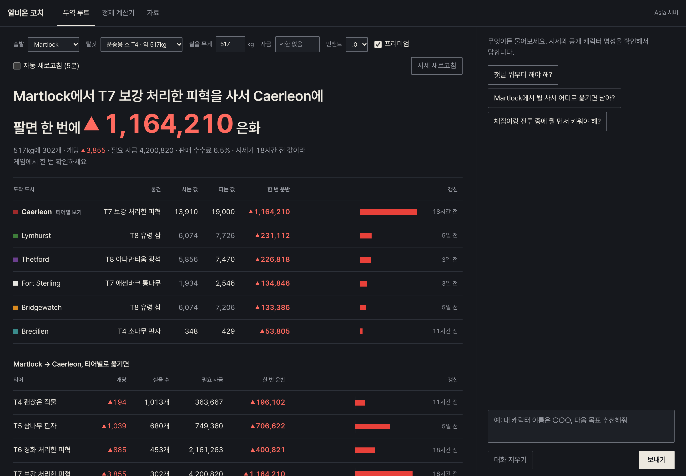
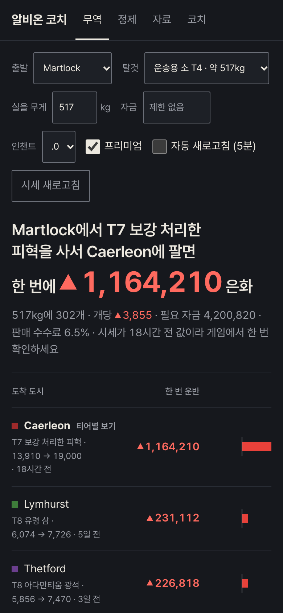
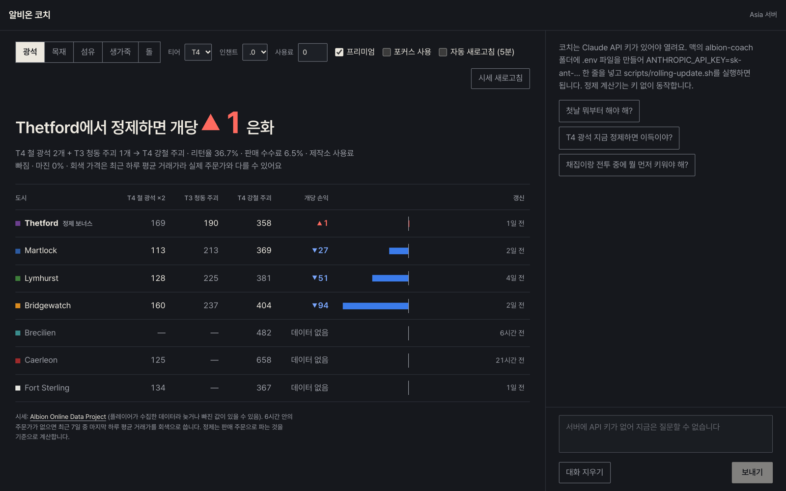
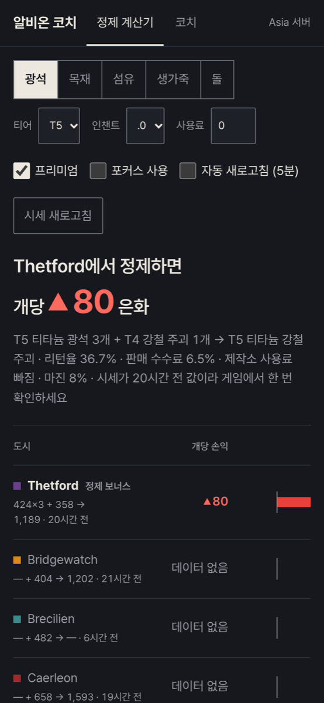
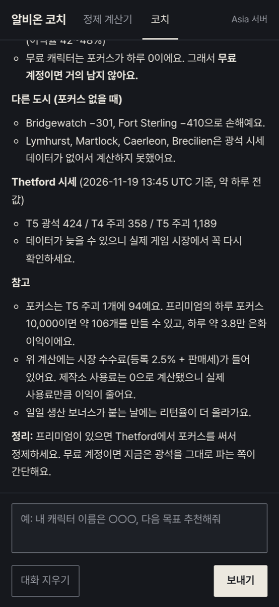
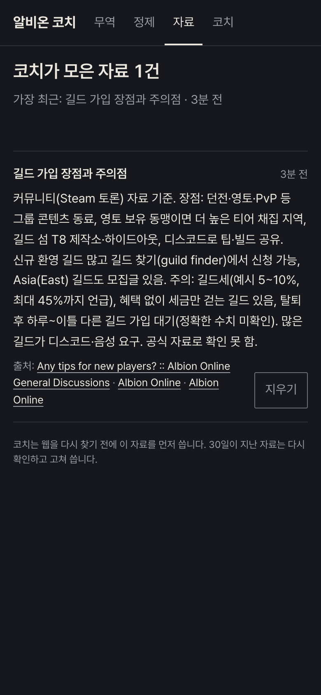

# 사용 가이드

알비온 온라인 **Asia 서버** 플레이어를 위한 보조 도구입니다. 게임 옆 화면(보조 모니터나 휴대폰)에 띄워 두고 씁니다.

- **무역 루트** (첫 화면): Martlock 같은 출발 도시에서 사서 다른 도시에 팔면 한 번 운반에 얼마 남는지, 어느 티어를 옮기면 좋은지 알려 줍니다. API 키 없이 동작합니다.
- **정제 계산기**: 지금 어느 도시에서 정제하면 남는지 알려 줍니다. API 키 없이 동작합니다.
- **코치**: 한국어로 묻고 답합니다. 시세, 무역 루트, 공개 캐릭터 명성을 직접 조회하고, 모르는 건 웹에서 찾아 답합니다. Claude API 키가 필요합니다.
- **자료**: 코치가 웹에서 찾은 사실을 출처와 함께 쌓아 둡니다. 다음에 비슷한 걸 물으면 웹 대신 이 자료로 바로 답합니다.

이 도구는 게임을 조작하지 않습니다. 게임 클라이언트에 입력을 보내거나 게임 메모리·패킷을 읽지 않고, 공개 API만 씁니다. 알비온 이용약관은 봇과 매크로를 금지합니다.

## 1. 준비물

| 필요한 것 | 용도 | 비고 |
| --- | --- | --- |
| Docker (Docker Desktop, Rancher Desktop, OrbStack 등) | 앱 실행 | `docker compose` 명령이 되어야 합니다 |
| Claude API 키 (선택) | 코치 | [console.anthropic.com](https://console.anthropic.com)에서 발급합니다. 질문할 때마다 요금이 나갑니다 |

## 2. 설치와 실행

```sh
git clone https://github.com/yun4010608-netizen/albion-coach.git
cd albion-coach
cp .env.example .env        # 코치를 쓸 때만: .env를 열어 ANTHROPIC_API_KEY= 뒤에 키를 붙여 넣기
                            # POSTGRES_PASSWORD= 뒤에 아무 긴 문자열을 넣으면 자료 DB 비밀번호가 됩니다(처음 실행 전에)
docker compose up -d --build
```

브라우저에서 `http://localhost:8080`을 엽니다.

- `.env`는 `.gitignore`와 `.dockerignore`에 들어 있어서 저장소에도, Docker 이미지에도 들어가지 않습니다. 키를 커밋하지 마세요.
- 코치 모델은 기본이 `claude-sonnet-5-5`입니다. 더 깊은 답이 필요하면 `.env`에 `CLAUDE_MODEL=claude-opus-5-5`를 넣으세요. 대신 느려지고 비용이 늘어납니다.

## 3. 무역 루트



1. **출발** 도시(기본 Martlock), **탈것**, **인챈트**를 고릅니다. 탈것을 고르면 **실을 무게**가 그 탈것의 추정치로 바뀝니다. 게임 인벤토리에 나오는 최대 무게를 직접 넣으면 더 정확해지고, 탈것은 '직접 입력'으로 바뀝니다.
2. **자금**에 쓸 수 있는 은화를 넣으면, 무게보다 돈이 먼저 바닥나는 경우를 반영합니다. 비워 두면 제한이 없습니다.
3. 맨 위 문장이 답입니다. 무엇을 사서 어디에 팔면 한 번 운반에 얼마 남는지 보여 줍니다. 아래에는 개수, 개당 이익, 필요 자금이 나옵니다.
4. **도착 도시** 표는 도시마다 가장 남는 물건과 사는 값·파는 값, 한 번 운반 이익을 보여 줍니다. 도시 이름을 누르면 아래 **티어별** 표가 그 도시 기준으로 바뀝니다.
5. **티어별** 표는 T4~T8 중 어느 티어를 옮기는 게 좋은지 비교합니다. 무거운 고티어는 개수가 줄지만 개당 이익이 커서, 한 번 운반 이익이 더 클 때가 많습니다.

계산 기준:
- 출발 도시의 최저가 판매 주문을 사서, 도착 도시에 판매 주문(최저가와 같은 값)으로 파는 기준입니다. 판매세와 등록비를 뺍니다.
- 최저가 주문이 몇 개 있는지는 알 수 없습니다. 수백 개를 사면 뒤로 갈수록 비싸질 수 있습니다.
- 운송용 소 무게는 게임 데이터로 계산한 추정치입니다(T3 413kg, T4 517kg, T5 689kg, T6 954kg, T7 1,349kg, T8 1,935kg). 실제 값과 다를 수 있습니다.
- 이동 시간과 PvP 위험은 빠져 있습니다. Caerleon은 가는 길에 레드 존을 지나야 할 수 있습니다.
- 회색 가격과 시세 시각은 정제 계산기와 같은 뜻입니다(아래 '가격 읽는 법').



## 4. 정제 계산기



1. **자원**(광석·목재·섬유·생가죽·돌), **티어**, **인챈트**를 고릅니다.
2. 맨 위 문장이 답입니다. 가장 남는 도시와 정제품 1개당 손익을 보여 줍니다. 빨간 ▲는 이익, 파란 ▼는 손해입니다.
3. 아래 표는 도시별 원자재·하위 정제품·정제품 가격, 손익 막대, 시세 시각입니다.
4. 옵션:
   - **프리미엄**: 판매세가 8%에서 4%로 내려갑니다.
   - **포커스 사용**: 리턴율이 올라갑니다(보너스 도시 기준 36.7%에서 53.9%로). 포커스는 프리미엄 캐릭터만 하루 10,000씩 찹니다.
   - **사용료**: 게임 제작소 창에 나오는 '영양 100당 은화'입니다. 모르면 0으로 두세요.
   - **자동 새로고침 (5분)**: 켜 두면 5분마다 시세를 다시 받습니다. 화면이 꺼져 있으면 쉬었다가, 다시 보는 순간 한 번 갱신합니다.
5. 마지막으로 고른 조건은 다음에 열 때 그대로 나옵니다.

**가격 읽는 법**

- 흰 숫자는 6시간 이내의 실제 판매 주문 최저가입니다.
- 회색 숫자는 최근 7일 중 마지막 하루의 평균 거래가입니다. Asia 서버는 주문 데이터가 비는 도시가 많아서 평균가로 채웁니다. 실제 주문가와 다를 수 있습니다.
- '데이터 없음'은 계산에 필요한 가격 중 하나가 없다는 뜻입니다.
- **운반까지 하면** 줄은 '싼 도시에서 사서, 보너스 도시에서 정제하고, 비싼 도시에서 팔기'입니다. 6시간 이내의 실제 주문가만으로 계산하고, 이동 중 PvP 위험은 빠져 있습니다.

시세는 플레이어들이 [Albion Data Client](https://www.albion-online-data.com/)로 모은 커뮤니티 데이터입니다. 게임에서 이 클라이언트를 켜고 시장을 열면 내 데이터도 공유되어 모두의 시세가 정확해집니다. 개발사가 허용한 무료 도구입니다.



## 5. 코치



- 상단 **코치** 탭(휴대폰) 또는 오른쪽 칸(데스크톱)에서 질문합니다. Enter로 보내고, Shift+Enter로 줄을 바꿉니다.
- 이런 질문에 잘 답합니다.
  - "첫날 뭐부터 해야 해?"
  - "T5 광석 지금 정제하면 이득이야? 어느 도시가 좋아?"
  - "내 캐릭터 이름은 ○○○, 명성 보고 다음 목표 추천해줘" (Asia 서버의 공개 명성을 조회합니다)
  - "노랑 존에서 죽으면 뭘 잃어?"
  - "Martlock에서 T5 소로 뭘 옮기면 남아?"
  - "개인 섬은 어떻게 사? 뭘 키우면 돈 돼?" (가이드에 없으면 웹에서 찾아봅니다)
- 답의 근거는 [초반 가이드](../knowledge/guide.md)(2026-11-20 조사), 실시간 시세, 공식 공개 API, 그리고 웹 검색입니다. 웹에서 찾은 답은 끝에 **출처** 링크가 붙습니다. 공식 위키·공지를 먼저 보지만, 커뮤니티 글은 틀릴 수 있으니 출처를 확인하세요.
- 웹 검색은 토큰 요금과 별도로 검색 1,000건당 $10가 나갑니다. 질문 하나에 보통 0~5번 검색합니다.
- 대화는 이 브라우저에만 저장됩니다. **대화 지우기**를 두 번 누르면 지워집니다.
- 키가 없으면 코치 탭이 잠기고, 무역 루트와 계산기는 그대로 동작합니다.

## 6. 자료



- 코치가 웹에서 찾은 것 중 다시 쓸 만한 사실(게임 규칙, 비용, 방법)을 주제별로 저장합니다. 시세나 캐릭터 정보는 저장하지 않습니다.
- 저장할 때 출처가 그 답에서 실제로 검색한 페이지인지 서버가 확인합니다. 확인되지 않는 출처만 있는 자료는 저장하지 않습니다.
- 다음 질문에서 코치는 웹보다 이 자료를 먼저 찾습니다. 그래서 답이 빠르고 검색 요금이 들지 않습니다. 이 자료로 답할 때도 끝에 출처가 붙습니다.
- 30일이 지난 자료는 코치가 다시 검색해서 고쳐 씁니다. 같은 주제는 새 내용으로 덮어씁니다.
- 틀린 자료는 **지우기**를 두 번 눌러 지웁니다.
- 자료는 Docker 볼륨 `notes`에 남아서 재시작·업데이트해도 유지됩니다. `docker compose down -v`를 하면 지워집니다.

## 7. 휴대폰에서 쓰기

1. 휴대폰을 PC와 같은 Wi-Fi에 연결합니다.
2. PC의 IP를 확인합니다. Mac은 `ipconfig getifaddr en0`, Windows는 `ipconfig`입니다.
3. 휴대폰 브라우저에서 `http://<PC IP>:8080`을 엽니다. 코치 탭을 바로 열려면 `http://<PC IP>:8080/#coach`입니다.
4. Safari의 '홈 화면에 추가'나 Chrome의 '홈 화면에 추가'로 앱처럼 쓸 수 있습니다.

**휴대폰에서 안 열릴 때**

- Rancher Desktop은 기본 설정에서 포트를 PC 자신(127.0.0.1)에만 엽니다. 관리자 권한을 켜거나(`rdctl set --application.admin-access=true`), 포워더를 띄우세요: `socat TCP-LISTEN:8090,fork,reuseaddr TCP:127.0.0.1:8080`. 포워더를 쓰면 휴대폰에서는 `:8090`으로 엽니다.
- Mac 방화벽이 켜져 있으면 '들어오는 연결 허용' 창이 뜰 수 있습니다. 허용해야 합니다.
- 같은 Wi-Fi의 누구나 접속할 수 있고, 코치 비용은 키 주인에게 나갑니다. 카페 같은 공용 네트워크에서는 열지 마세요.

## 8. 업데이트·재시작·종료

| 하고 싶은 것 | 명령 | 비고 |
| --- | --- | --- |
| 새 버전 받기 | `git pull && scripts/rolling-update.sh` | 중단 없이 새 컨테이너로 교체 |
| 키·모델 바꾸기 | `.env` 수정 후 `scripts/rolling-update.sh` | |
| 재시작 | `scripts/rolling-restart.sh` | 한 대씩 재시작, 진행 중인 답변은 끝까지 처리 |
| 종료 | `docker compose down` | 자료는 남음 (`-v`를 붙이면 자료도 지움) |
| 로그 보기 | `docker compose logs -f app` | |

## 9. 문제 해결

| 증상 | 원인과 해결 |
| --- | --- |
| 코치 탭에 "API 키가 있어야 열려요" | `.env`에 `ANTHROPIC_API_KEY`가 없거나 비어 있음. 키를 넣고 `scripts/rolling-update.sh` |
| "코치 응답을 받지 못했습니다" | 키가 틀렸거나 크레딧이 부족함. `docker compose logs app`에서 오류 확인 |
| 웹 검색 없이 "찾아볼 수 없다"고 답함 | Claude Console에서 조직 관리자가 웹 검색을 꺼 두었을 수 있음. Console 설정에서 웹 검색을 켜기 |
| "시세 API 호출 한도 초과" | 커뮤니티 API 제한(분당 100회)에 걸림. 앱이 5분간 쉬고 캐시를 씀. 기다리면 풀림 |
| 대부분 '데이터 없음' | 해당 조합의 Asia 거래 기록이 7일 안에 거의 없음. 다른 티어를 보거나 Albion Data Client로 시세를 공유 |
| 자료 탭에 "자료 저장소에 연결하지 못했습니다" | DB 컨테이너가 멈춤. `docker compose up -d db` 후 자료 탭을 다시 열기. 그동안 코치는 웹 검색으로 답함 |
| 무역 루트 이익이 게임과 많이 다름 | 실을 무게가 추정치이거나 시세가 오래됨. 게임의 최대 무게를 넣고, 회색·오래된 가격은 게임에서 확인 |
| `localhost:8080`이 안 열림 | `docker compose ps`로 컨테이너가 healthy인지 확인. 8080을 다른 프로그램이 쓰고 있으면 `compose.yaml`의 `ports`를 바꾸기 |
